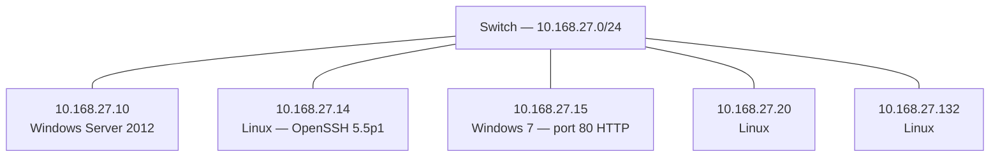

# Network & Wireless Security Assessment

A two-part security assessment: (1) enumerating a small network's topology, hosts, and
services to identify and prioritize vulnerabilities, and (2) evaluating WLAN and mobile
(BYOD) risks with mitigations and regulatory justification.

> Scenario-based lab. All addresses, hosts, and captures are synthetic.

## Part 1 — Network topology & vulnerability assessment

A scan of `10.168.27.0/24` revealed a **star topology**: five hosts on a switch, two Windows
and three Linux. Host/port enumeration (Nmap) plus traffic capture (Wireshark) surfaced the
issues below.

### Topology

See [`topology.mmd`](./topology.mmd) (Mermaid). Rendered:



### Vulnerabilities & recommendations

| Host | Finding | Risk | Recommendation |
|---|---|---|---|
| 10.168.27.10 | Windows Server 2012 (EOL 2018) | Unpatched OS, no security updates | Migrate to a supported Windows Server version |
| 10.168.27.14 | OpenSSH 5.5p1 (Debian), port 22 | Obsolete SSH, missing patches | Upgrade Debian/OpenSSH; keep patched |
| 10.168.27.15 | Port 80/TCP open, plaintext HTTP | MITM / eavesdropping / tampering | Close 80 or redirect to 443 (HTTPS/HSTS) |

Traffic-capture anomalies (e.g., cleartext credentials, unexpected outbound flows) were
documented with packet ranges and tied to the "no action" business impact of each.

## Part 2 — WLAN & mobile / BYOD security

- **WLAN vulnerabilities:** weak/legacy encryption and rogue-AP / evil-twin exposure.
- **Mobile vulnerabilities:** unmanaged devices, sideloaded apps, lost/stolen device data risk.
- **Mitigations:** WPA3-Enterprise + 802.1X, wireless IDS, MDM enrollment, containerization,
  remote wipe.
- **Preventive measures:** guidance from NIST SP 800-153 (WLAN) and NIST SP 1800-22 (BYOD),
  with regulatory justification (not just standards).

See [`hardening-checklist.md`](./hardening-checklist.md) for the consolidated control list.

## What's in this repo

- `README.md` — this case study.
- `topology.mmd` — network diagram as code (Mermaid).
- `nmap_findings.csv` — structured host/port/service/vulnerability data.
- `triage.py` — a small Python tool that reads the Nmap findings and prints a
  risk-prioritized remediation list.
- `hardening-checklist.md` — WLAN + mobile + host hardening controls mapped to NIST guidance.
- `sample_output.txt` — example run.

## Running the tool

```bash
python3 triage.py nmap_findings.csv
```

## Skills demonstrated

Network enumeration (Nmap) · service/version vulnerability identification · packet analysis
(Wireshark) · topology documentation · WLAN/BYOD security · mapping controls to NIST SP
800-153 / 1800-22 · risk-based remediation prioritization.
